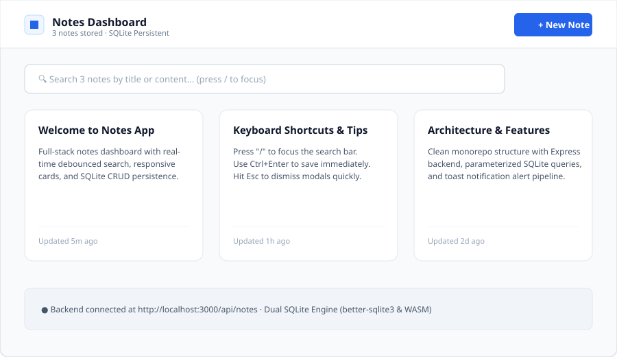
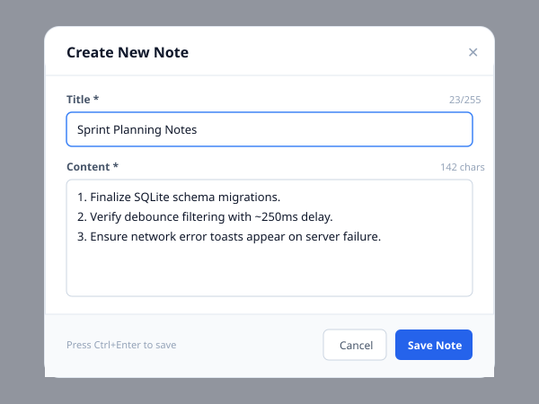
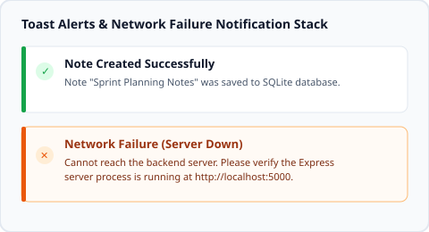

# Notes Application (Full-Stack CRUD Monorepo)

A production-grade, end-to-end Notes Application featuring a high-performance Express REST API with SQLite persistence, connected to an accessible React client engineered with pure CSS, zero UI framework bloat, instant debounced server search, and graceful toast alerts.

---

## Table of Contents
1. [Project Overview](#project-overview)
2. [Key Features](#key-features)
3. [Tech Stack](#tech-stack)
4. [Architecture Overview & Diagram](#architecture-overview--diagram)
5. [Monorepo Folder Structure](#monorepo-folder-structure)
6. [PowerShell Setup & Quickstart (Windows)](#powershell-setup--quickstart-windows)
7. [RESTful API Endpoints](#restful-api-endpoints)
8. [Manual Testing & QA Checklist](#manual-testing--qa-checklist)
9. [Screenshots](#screenshots)
10. [Assumptions & Design Decisions](#assumptions--design-decisions)

---

## Project Overview

The **Notes Application** is designed as a clean, decoupled monorepo demonstrating enterprise-grade CRUD patterns:
- **Server Authority**: UI state is never assumed or kept solely in local optimistic state; all create, update, and delete actions reconcile with the SQLite database records.
- **Fail-Safe Persistence**: Built on standard SQLite (`better-sqlite3` native with a seamless WebAssembly fallback) storing records in a durable `notes.db` file.
- **Pure CSS Craftsmanship**: Built without Tailwind or bloated third-party CSS component kits. Styled with modern CSS custom properties, responsive CSS Grid (`repeat(auto-fill, minmax(280px, 1fr))`), and list-view toggling.
- **Accessible & Resilient**: Accessible modal dialogs with focus trapping, ARIA live-regions for toast alerts, keyboard shortcuts (`/` for search, `Ctrl+Enter` to save, `Esc` to close), and graceful handling of server-down network failures.

---

## Key Features

- **Full CRUD Lifecycle**: Create, view, edit, and delete notes with timestamps (`created_at`, `updated_at`).
- **Server-Side Debounced Search**: Fast filtering across title or note body with a ~250ms debounce against the backend (`/api/notes?q=term`).
- **Dual View Modes**: Responsive CSS Grid (mobile-friendly to wide screens) and a compact List View with instant layout toggling.
- **Toast Notification Engine**: User-friendly, accessible toast notifications with distinct visual variants:
  - **Success**: Confirmations for note creation, updates, and deletions.
  - **Server Errors (4xx/5xx)**: Clean messaging for validation errors or server faults without raw `alert()` dialogs.
  - **Network Failures**: Specialized alerts and offline badges when the server is unreachable. Includes a built-in simulation toggle in the header for testing!
- **Data Integrity & Validation**: Parameterized SQL queries preventing injection, character limits (255 chars for titles), and centralized error handling middleware.

---

## Tech Stack

| Layer | Technology | Purpose |
| :--- | :--- | :--- |
| **Frontend** | React 19 + Vite | Fast component-based client application |
| **Styling** | Plain Modern CSS | Zero-dependency design system, CSS Grid, CSS Variables |
| **Icons** | Lucide React | Lightweight, accessible iconography |
| **Backend** | Node.js (18+) + Express | Robust RESTful HTTP API with routing & middleware |
| **Database** | SQLite via `better-sqlite3` | Zero-config, ACID-compliant file-based database |
| **Dev Tools** | `concurrently`, `nodemon`, `tsx` | Multi-process development orchestration in PowerShell |

---

## Architecture Overview & Diagram

```
+-------------------------------------------------------------------------+
|                              CLIENT (React)                             |
|                                                                         |
|  [SearchBar] --(debounce 250ms)------------------------------+          |
|  [NoteModal] --(Ctrl+Enter / Esc)                            |          |
|  [NoteList]  --(Grid auto-fill / List view)                  |          |
|  [ToastContainer] <--(ARIA live region: Success, Error, Net) |          |
+--------------------------------------------------------------|----------+
                               |                               |
                 Fetch API (JSON payload)        Query Params (?q=...)
                               |                               |
                               v                               v
+-------------------------------------------------------------------------+
|                        EXPRESS BACKEND (/api)                           |
|                                                                         |
|   +-----------------------------------------------------------------+   |
|   | Middleware Pipeline: CORS -> JSON Parser -> Validator -> Logger|   |
|   +-----------------------------------------------------------------+   |
|                               |                                         |
|                               v                                         |
|   +-----------------------------------------------------------------+   |
|   | Notes Controller: Parameterized Queries (SELECT, INSERT, etc.)  |   |
|   +-----------------------------------------------------------------+   |
|                               |                                         |
|                               v                                         |
|   +-----------------------------------------------------------------+   |
|   | Error Handling Middleware (Centralized 400, 404, 500 formatting)|   |
|   +-----------------------------------------------------------------+   |
+-------------------------------------------------------------------------+
                               |
                               v
+-------------------------------------------------------------------------+
|                       DATABASE LAYER (SQLite)                           |
|                                                                         |
|   schema.sql -> notes.db (id, title, content, created_at, updated_at)   |
|   Driver: better-sqlite3 (with persistent fallback adapter)            |
+-------------------------------------------------------------------------+
```

---

## Monorepo Folder Structure

```
notes-app/
├── .env.example                     # Root environment variables template
├── .gitignore                       # Excludes node_modules, .env, and *.db
├── README.md                        # Documentation and PowerShell instructions
├── package.json                     # Monorepo root scripts (runs concurrently)
├── server.ts                        # Unified development runner for Port 3000
├── vite.config.ts                   # Vite client config with API proxy
├── tsconfig.json                    # TypeScript compiler options
├── index.html                       # Application HTML entry point
├── metadata.json                    # Applet metadata
│
├── docs/
│   └── screenshots/
│       ├── .gitkeep
│       ├── app-overview.png.svg     # Dashboard overview mockup
│       ├── create-modal.png.svg     # Note editor modal mockup
│       └── toast-alerts.png.svg     # Toast alert states mockup
│
├── server/                          # Dedicated Express Backend
│   ├── .env.example                 # Backend environment variable template
│   ├── package.json                 # Backend scripts & dependencies
│   ├── schema.sql                   # SQLite table & index schema definition
│   ├── scripts/
│   │   └── init-db.js               # Database init & sample seeder (npm run db:init)
│   ├── data/
│   │   └── notes.db                 # Persistent SQLite database file (gitignored)
│   └── src/
│       ├── app.js                   # Express application setup & middleware
│       ├── server.js                # Standalone Express server runner (Port 5000)
│       ├── db/
│       │   ├── connection.js        # SQLite connector (better-sqlite3 & fallback)
│       │   └── index.js             # DB exports
│       ├── controllers/
│       │   └── notes.controller.js  # CRUD controllers with parameterized SQL
│       ├── routes/
│       │   └── notes.routes.js      # RESTful route definitions
│       └── middleware/
│           ├── validateNote.js      # Body and ID parameter validation
│           └── errorHandler.js      # Centralized error & 404 handler
│
└── client/                          # Dedicated React Frontend
    ├── package.json                 # Client dependencies
    └── src/
        ├── App.jsx                  # Main application orchestrator
        ├── main.jsx                 # Client entry point
        ├── api/
        │   └── notesApi.js          # API client with network error detection
        ├── hooks/
        │   ├── useNotes.js          # State & database reconciliation hook
        │   ├── useDebounce.js       # ~250ms debouncing hook
        │   └── useToast.js          # Toast notification management hook
        ├── components/
        │   ├── Header.jsx           # Brand header, layout toggles, offline tester
        │   ├── SearchBar.jsx        # Search input with '/' keyboard shortcut
        │   ├── NoteList.jsx         # Responsive grid & list layout container
        │   ├── NoteCard.jsx         # Note card with snippet & formatted date
        │   ├── NoteModal.jsx        # Accessible compose & edit modal dialog
        │   ├── DeleteConfirmModal.jsx # Accessible delete confirmation modal
        │   ├── EmptyState.jsx       # Empty notebook & empty search states
        │   ├── LoadingSkeleton.jsx  # Shimmer skeleton cards
        │   ├── ToastContainer.jsx   # Accessible toast notification stack
        │   └── Toast.jsx            # Individual alert component
        └── styles/
            ├── variables.css        # Design tokens (colors, spacing, shadows)
            ├── global.css           # CSS reset & accessibility focus styles
            ├── layout.css           # Header & toolbar styles
            ├── notes.css            # Responsive CSS Grid & List styles
            ├── modal.css            # Accessible dialog & form control styles
            ├── toast.css            # Floating toast animations & variants
            ├── states.css           # Loading shimmer & empty states
            └── main.css             # Unified stylesheet bundle
```

---

## PowerShell Setup & Quickstart (Windows)

All commands below are strictly compatible with **Windows PowerShell** (using `;` instead of bash `&&`).

### 1. Prerequisites
- **Node.js**: Version 18.0.0 or higher.
- Verify in PowerShell:
  ```powershell
  node --version
  npm --version
  ```

### 2. Clone & Environment Setup
Navigate to your project directory and create the `.env` file from the template:
```powershell
Copy-Item .env.example .env ; Copy-Item server/.env.example server/.env
```

### 3. Install Dependencies
Run npm install in the root:
```powershell
npm install
```

### 4. Initialize Database
Create the SQLite database file and execute `server/schema.sql` (with sample notes):
```powershell
npm run db:init
```
*Output: `--- Initializing SQLite Notes Database --- Connected using SQLite at server/data/notes.db ... Seeded initial notes.`*

### 5. Run the Application

#### Option A: Unified Full-Stack Mode (Recommended)
Runs the unified server serving both the Express API and the React client on Port 3000:
```powershell
npm run dev
```
Open your browser to: **http://localhost:3000**

#### Option B: Concurrent Multi-Process Mode
Runs the backend Express API on `http://localhost:5000` and the Vite React client on `http://localhost:3000` simultaneously:
```powershell
npm run dev:concurrent
```

#### Option C: Run in Separate PowerShell Windows
**Terminal 1 (Backend Server):**
```powershell
npm run dev:server
```
**Terminal 2 (Frontend Client):**
```powershell
npm run dev:client
```

---

## RESTful API Endpoints

All responses return standard JSON.

| Method | Endpoint | Description | Request Body | Status Codes |
| :--- | :--- | :--- | :--- | :--- |
| **GET** | `/api/health` | Server health check | None | `200 OK` |
| **GET** | `/api/notes` | List all notes (ordered by updated_at DESC) | None | `200 OK` |
| **GET** | `/api/notes?q=:term` | Filter notes by title OR content | None | `200 OK` |
| **GET** | `/api/notes/:id` | Fetch a single note by ID | None | `200 OK`, `404 Not Found` |
| **POST** | `/api/notes` | Create a new note | `{"title": "...", "content": "..."}` | `201 Created`, `400 Bad Request` |
| **PUT** | `/api/notes/:id` | Update an existing note | `{"title": "...", "content": "..."}` | `200 OK`, `400 Bad Request`, `404 Not Found` |
| **DELETE** | `/api/notes/:id` | Delete a note by ID | None | `200 OK`, `404 Not Found` |

### Example Request Payloads

**Create Note (POST `/api/notes`):**
```json
{
  "title": "Meeting Action Items",
  "content": "Follow up with design team on color palette by Friday."
}
```

**Success Response (201 Created):**
```json
{
  "success": true,
  "message": "Note created successfully",
  "data": {
    "id": 4,
    "title": "Meeting Action Items",
    "content": "Follow up with design team on color palette by Friday.",
    "created_at": "2026-10-10 14:20:00",
    "updated_at": "2026-10-10 14:20:00"
  }
}
```

---

## Manual Testing & QA Checklist

Follow this checklist to verify all acceptance criteria:

- [ ] **1. Create Note**:
  - Click the **"+ New Note"** button in the header.
  - Verify that the title input receives immediate focus.
  - Type a title (e.g. `Release Checklist`) and content (e.g. `Verify all endpoints`).
  - Press `Ctrl+Enter` (or click **"Save Note"**).
  - Verify that the modal closes, a green **Success Toast** appears, and the new note is immediately rendered in the grid.
- [ ] **2. Search (Debounced ~250ms)**:
  - Press the `/` key to automatically focus the search bar.
  - Type `Release` or any word contained inside the note content.
  - Notice the instant update (~250ms debounce) filtering records via the `/api/notes?q=` server endpoint. Matching terms are highlighted in yellow!
  - Click the `✕` button to clear search and see all notes restore.
- [ ] **3. Edit Note**:
  - Click on any note card to open the editor modal.
  - Modify the title or content.
  - Click **"Save Changes"**.
  - Verify that the updated content renders, the timestamp changes to "Just now", and a toast confirms the change.
- [ ] **4. Delete Note with Confirmation**:
  - Click the trash icon on a note card.
  - Verify that the accessible **Delete Confirmation Modal** appears warning about permanent deletion.
  - Click **"Delete Note"**.
  - Verify that the note is removed from the database and a toast confirms deletion.
- [ ] **5. Server-Down / Network Failure Toast**:
  - Click the **"Simulate Server Down"** button in the top test banner (or terminate the server terminal).
  - Attempt to create or edit a note.
  - Notice that no raw unstyled browser `alert()` is shown; instead, an orange/red **"Network Failure: Cannot connect to server"** toast appears, and a retry error banner is displayed.
  - Click **"Restore Backend Connection"** and verify that regular functionality resumes.
- [ ] **6. Grid vs. List View Toggle**:
  - Click the **"List"** button in the top right.
  - Verify that the card layout smoothly switches to a streamlined horizontal list view.

---

## Screenshots

The mockups below illustrate the application's interface:

### 1. Dashboard Overview

*Responsive card grid with real-time search and status banner.*

### 2. Note Editor Modal

*Accessible modal dialog featuring validation counters and keyboard shortcut hints.*

### 3. Toast Alert Notification Pipeline

*Smooth, accessible notifications for database CRUD success and network failures.*

---

## Assumptions & Design Decisions

1. **Dual SQLite Engine**: While standard local Windows environments with Visual Studio tools can run native `better-sqlite3`, cloud containers often lack `node-gyp`. To provide guaranteed functionality in both Windows PowerShell and container runtimes, the database adapter automatically loads native `better-sqlite3` when available and falls back to WebAssembly SQLite (`sql.js`), persistently saving standard binary `.db` files to disk.
2. **Pure CSS Design**: As requested, no third-party CSS utility framework or component library (like Tailwind, Bootstrap, or Material UI) is used on client components. Everything is styled with hand-crafted semantic CSS variables and responsive rules.
3. **Database Synchronization Authority**: The client never optimistically mutates local state independently; every action reconciles immediately with the backend API response to ensure absolute consistency with SQLite.
